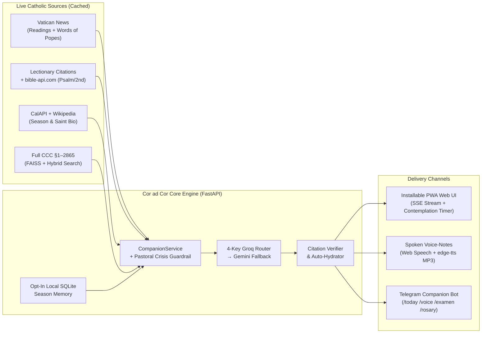

# Cor ad Cor — Catholic Daily Liturgical & Spiritual Companion

[](https://github.com/JosephJonathanFernandes/cor-ad-cor/actions/workflows/ci.yml)

> *"Heart speaks to heart."* — St. John Henry Newman

**Cor ad Cor** is a grounded Catholic daily liturgical and spiritual companion that brings **today's Mass readings**, the **Saint of the Day**, **The Words of the Popes**, the **Rosary of the Day**, and the **full 2,865-paragraph Catechism of the Catholic Church (`CCC §1–2865`)** into plain, unhurried human language—delivered in a warm, reflective spiritual-companion voice with strict citation verification.

## Architecture



## Features Across All Phases

- **Phase 1 — Grounded Core Engine:**
  - **4-Key Groq Rotation + Gemini Fallback** (`app/llm/router.py`) with per-key rate-limit cooldowns.
  - **Full Catechism (`CCC §1–2865`) RAG** (`app/rag/catechism.py`, `scripts/fetch_ccc_full.py`) with exact `CCC §` lookup, hybrid FAISS + lexical search, and automatic post-generation **Citation Verification & Auto-Hydration** (`app/rag/verifier.py`).
  - **Live Liturgical Pipeline** (`app/data_sources/liturgy.py`): Vatican News Word of the Day (Readings + *The Words of the Popes*), Lectionary Citations API + `bible-api.com` full Psalm/Second Reading hydration, CalAPI liturgical season/color, and cached Wikipedia Saint biographies.
- **Phase 2 — "Bring Your Day to Today's Mass" Web App (PWA):**
  - Calm, ad-free "Liturgical Sanctuary" interface with **Morning Light / Evening Vigil** themes, SSE token streaming (`/api/v1/daily/stream`), interactive clickable `[CCC §N]` and `[Gospel]` citation pills, and zero-key **Instant Preview** mode.
- **Phase 3 — Evening Ignatian Examen, Season Memory & Confession Prep:**
  - **3-Minute Nightly Ignatian Examen** (`POST /api/v1/examen`), opt-in local SQLite season theme continuity (`GET /api/v1/memory`, `GET /api/v1/memory/export`, `DELETE /api/v1/memory`), and a **Gentle, Non-Scrupulous Confession Prep Helper** (`POST /api/v1/confession-prep`) with 1-click Copy & Pocket Print layout.
- **Phase 4 & Enhancements — Audio, Telegram, Lectio Divina & Rosary:**
  - **Guided 4-Step *Lectio Divina*** (`POST /api/v1/lectio`) with a **1 / 3 / 5-minute Quiet Contemplation Timer** and gentle bell chime.
  - **Daily Rosary Mysteries** (`GET /api/v1/rosary`, Telegram `/rosary`) with Scripture, Fruits, and `CCC §` anchors.
  - **Spoken Voice-Notes** (`POST /api/v1/audio/voice-note` via `edge-tts`) + **Telegram Bot** (`scripts/run_telegram_bot.py` & `POST /api/v1/telegram/webhook`) + **Scheduled Digest** (`scripts/send_daily_digest.py`).
  - **Production Ready:** Per-IP rate limiting & security headers (`app/middleware.py`), `Dockerfile`, `docker-compose.yml`, `render.yaml`, and GitHub Actions CI.

## Quickstart

```powershell
python -m venv .venv
.venv\Scripts\pip install -r requirements.txt
Copy-Item .env.example .env
# Add GROQ_API_KEY_1..4, GEMINI_API_KEY, and optional TELEGRAM_BOT_TOKEN in .env

# Download, normalize, and FAISS-index all 2,865 Catechism paragraphs (CCC §1–§2865)
.venv\Scripts\python scripts\fetch_ccc_full.py

# Start the Web App & API server
.venv\Scripts\uvicorn app.main:app --reload
# Open http://127.0.0.1:8000 in your browser

# Run the test suite or live liturgical smoke test
.venv\Scripts\pytest -v
.venv\Scripts\python scripts\smoke_live.py
```

## Docker / Cloud Deployment

```powershell
docker compose up --build
```
Or deploy directly via the included [`render.yaml`](render.yaml) blueprint.

> **Pastoral Boundary:** *Cor ad Cor* is a prayerful companion grounded in Sacred Scripture and the Catechism of the Catholic Church. It is not a substitute for professional mental health counseling, spiritual direction, or the Sacrament of Penance and Reconciliation with a Catholic priest.
